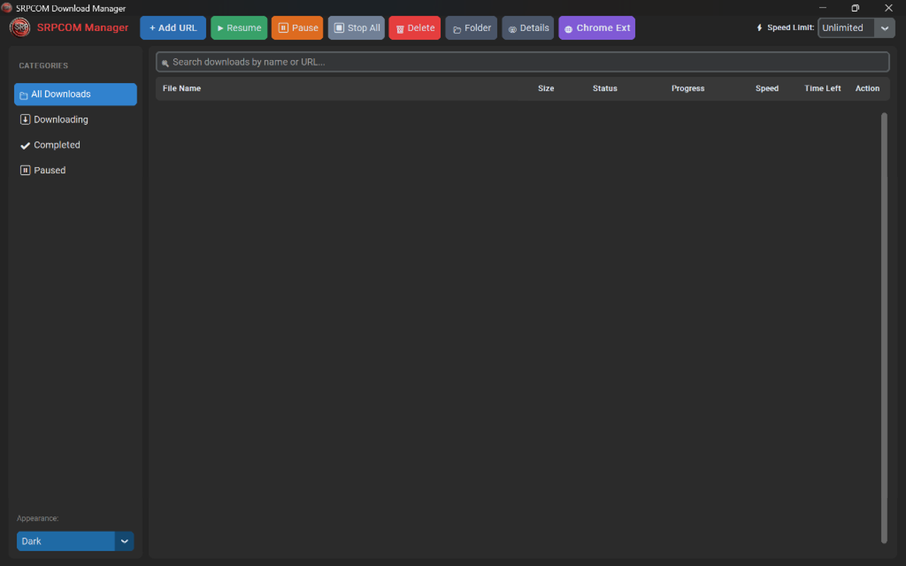

<p align="center">
  
</p>

<h1 align="center">⚡ SRPCOM Download Manager (SDM)</h1>

<p align="center">
  <b>A modern, high-speed, multi-threaded download accelerator and video grabber for Windows.</b><br />
  <i>Engineered with IDM-like instant popup interception, YouTube streaming downloader, and seamless browser integration.</i>
</p>

<p align="center">
  <a href="https://github.com/syamsul18782/srpcom-download-manager/releases/latest"></a>
  
  
  
</p>

---

<p align="center">
  
</p>

---

## ✨ Overview

**SRPCOM Download Manager (SDM)** adalah aplikasi manajer unduhan modern untuk Windows yang dirancang sebagai alternatif tangguh untuk IDM. Dibangun dengan antarmuka **CustomTkinter Dark Theme** yang elegan, akselerasi unduhan berbasis multi-segmentasi HTTP Range, integrasi ekstensi browser Chrome/Edge, serta kemampuan mendownload video YouTube dan web streaming langsung saat diputar.

---

## 🚀 Fitur Unggulan

| Fitur | Deskripsi |
| :--- | :--- |
| **⚡ Multi-Thread Engine** | Memecah file hingga **32 segmen koneksi simultan** menggunakan HTTP byte-range request untuk memaksimalkan bandwidth. |
| **🎥 YouTube & Stream Grabber** | Tombol melayang *"Download Video ini"* muncul otomatis di atas video YouTube / web player. Pilih resolusi 1080p, 720p, 480p, atau Ekstrak MP3. |
| **🔔 IDM-Style Topmost Popup** | Begitu link tertangkap dari browser atau clipboard, jendela SDM **langsung melompat ke depan layar (TopMost)** di depan browser Anda. |
| **📁 Category Memory Folder** | Mengingat direktori folder tujuan berdasarkan kategori (Video ke `D:\Videos`, Musik ke `D:\Music`, dll). |
| **⏸️ Reliable Pause & Resume** | Hentikan unduhan kapan saja dan lanjutkan kembali tanpa kehilangan progres data di disk. |
| **🚦 Global Speed Limiter** | Batasi pemakaian bandwidth internet (*Unlimited*, 256 KB/s, 512 KB/s, 1 MB/s, hingga 10 MB/s). |
| **📊 Segment Visualizer** | Pantau progres bar masing-masing thread koneksi secara *real-time* via menu **Details**. |
| **🌐 Browser Extension Ready** | Dilengkapi ekstensi resmi untuk **Google Chrome** dan **Microsoft Edge**. |

---

## 📥 Download & Instalasi

Dapatkan versi terbaru langsung melalui menu [**GitHub Releases**](https://github.com/syamsul18782/srpcom-download-manager/releases/latest):

| Berkas | Tipe | Deskripsi |
| :--- | :---: | :--- |
| **[`SRPCOM_Setup.exe`](https://github.com/syamsul18782/srpcom-download-manager/releases/latest)** | 📦 Installer (~81 MB) | Setup wizard otomatis: membuat Desktop Shortcut, Start Menu, dan terdaftar di *Windows Installed Apps*. |
| **[`SRPCOM Download Manager.exe`](https://github.com/syamsul18782/srpcom-download-manager/releases/latest)** | 🚀 Portable (~37 MB) | Versi portable *standalone*, tanpa instalasi. Cukup klik ganda langsung berjalan. |
| **[`srpcom_extension.zip`](https://github.com/syamsul18782/srpcom-download-manager/releases/latest)** | 🧩 Ekstensi Chrome | Pasang di `chrome://extensions` (Developer Mode) untuk integrasi unduhan dan YouTube otomatis. |

---

## 🧩 Memasang Ekstensi Browser

1. Ekstrak file **`srpcom_extension.zip`** ke folder pilihan Anda.
2. Buka **Google Chrome** atau **Microsoft Edge**, lalu buka alamat `chrome://extensions`.
3. Aktifkan saklar **Developer mode** di pojok kanan atas.
4. Klik tombol **Load unpacked** dan pilih folder hasil ekstrak tadi.
5. Selesai! Tombol download otomatis aktif di video YouTube dan link unduhan.

---

## 💻 Menjalankan dari Kode Sumber (Developer)

### 1. Prasyarat
- **Python 3.10+** (disarankan Python 3.11)
- **FFmpeg** terpasang di sistem Windows PATH

### 2. Instalasi & Menjalankan
```powershell
# Clone repositori
git clone https://github.com/syamsul18782/srpcom-download-manager.git
cd srpcom-download-manager

# Buat virtual environment
python -m venv .venv
.\.venv\Scripts\Activate.ps1

# Install seluruh dependensi
pip install -r requirements.txt

# Jalankan aplikasi
python main.py
```

### 3. Kompilasi Executable (.EXE)
```powershell
# Kompilasi aplikasi utama (Portable EXE)
.\.venv\Scripts\pyinstaller.exe --noconsole --onefile --name "SRPCOM Download Manager" --icon "assets/logo.ico" --add-data "assets;assets" --add-data "browser_extension;browser_extension" --collect-all customtkinter --collect-all yt_dlp main.py

# Kompilasi Single-File Setup Installer
.\.venv\Scripts\pyinstaller.exe --noconsole --onefile --name "SRPCOM_Setup" --icon "assets/logo.ico" --add-data "payload;payload" --add-data "assets;assets" --add-data "browser_extension;browser_extension" --collect-all customtkinter installer.py
```

---

## ⌨️ Pintasan Keyboard Pop-up

- <kbd>Enter</kbd> : Mulai unduh saat ini juga (*Download Now*)
- <kbd>Esc</kbd> : Tutup / Batalkan dialog unduhan (*Cancel*)

---

<p align="center">
  <b>Developed with ❤️ by SRPCOM © 2026</b><br />
  <i>All rights reserved.</i>
</p>
